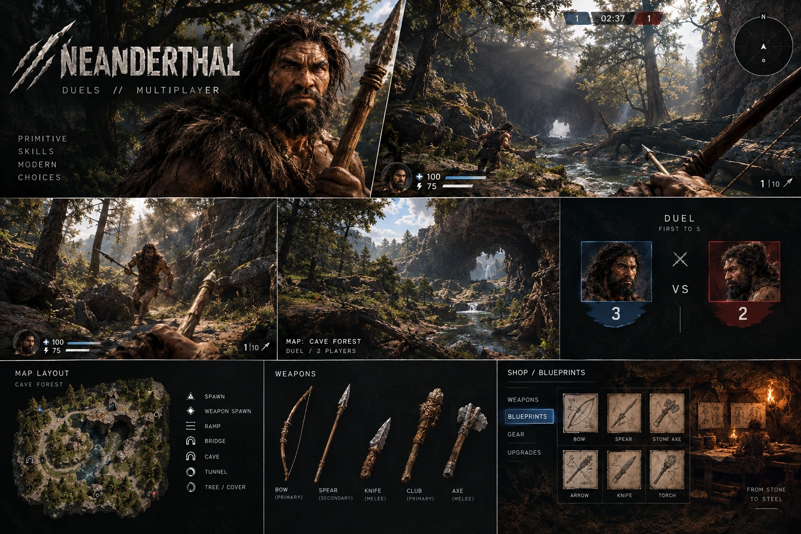

# NEANDERTHAL — Duels // Multiplayer

PvP-шутер від першої особи на Unity в дусі Half-Life / Counter-Strike, тільки про неандертальців:
луки, списи, ножі, кийки, сокири — а в магазині можна купити **креслення сучасної зброї** (*From stone to steel*).



## Як запустити

1. Встанови **Unity 6 (6000.0 LTS)** через Unity Hub (підійде й 2022.3+).
2. Unity Hub → **Add project from disk** → обери цю папку. Якщо Hub попросить іншу версію — обери свою встановлену.
3. Після першого відкриття проєкт сам створить сцену `Assets/Scenes/Main.unity` і додасть її в Build Settings
   (або вручну: меню **Neanderthal → Create Main Scene**).
4. Натисни **Play**.

Жодних імпортованих моделей не потрібно: увесь світ, зброя, персонажі, звуки та UI генеруються кодом
(блокаут із примітивів). Згодом їх замінюємо на справжні 3D-моделі.

> Гра працює навіть із будь-якої порожньої сцени — `GameBootstrap` сам створить `GameManager`.

## Режими

| Режим | Опис |
|---|---|
| **PvP Arena — Duel 1×1** | Ти проти суперника, перемога — перший до 5 вбивств або більше вбивств за 5 хвилин. |
| **PvP Arena — Deathmatch** | Усі проти всіх (3 або 5 суперників). |
| **Training — Survival Valley** | Одиночна долина з концепту: збір ресурсів, крафт, полювання, печера з мамонтом, торговець, табір суперників, вежа. |

Карти арени з концепт-артів:
- **Cave Forest** — сосновий ліс, струмок, ставок, два мости, печерний тунель крізь пагорб, скельна полиця з пандусом.
- **Canyon Fortress** — червоний каньйон, кам'яна фортеця 40×40 з проходами на стінах, пандусами, воротами-тунелями й центральною платформою.

На картах розкидана зброя, стріли, болти, цілющі трави й броня; вони з'являються знову кожні 20–40 с.

> Зараз суперники — **боти** (стріляють з упередженням, стрейфляться, б'ють списом зблизька).
> Правила матчу (рахунок, відродження, нагороди) вже рахуються окремо для кожного учасника, тож мережеву гру
> підключаємо наступним кроком — див. [docs/GAME_DESIGN.md](docs/GAME_DESIGN.md#мережева-гра).

## Керування

| Клавіша | Дія |
|---|---|
| WASD / Space / Shift / Ctrl | рух / стрибок / біг (витривалість) / присід |
| ЛКМ | удар · натягнути тятиву (тримати) · постріл |
| ПКМ | прицілитись / приціл · **тримати й відпустити, щоб кинути спис** |
| R | перезарядка |
| 1–5, коліщатко | вибір зброї |
| E | взаємодія (торговець, верстак, вогнище) |
| Tab | крафт (Survival) |
| H | з'їсти цілющі трави (+35 HP) |
| Esc | пауза |

## Зброя та прогрес

- **Примітивна** (доступна завжди): кулаки, кам'яний ніж, кістяний кинджал, кийок, кам'яна сокира, смолоскип, спис, лук.
- **Креслення** (купуються в **SHOP / BLUEPRINTS** за монети, назавжди): Bow (Modern), Crossbow, Pistol, Shotgun,
  Assault Rifle, Sniper Rifle, Armor Vest, Workbench.
- В **арені** куплене креслення відкриває зброю для набору (Primary / Secondary / Melee).
- У **Survival** зброю з креслення треба ще виготовити на верстаку з **Metal Parts**.
- Монети: +10 за вбивство, +150 за перемогу, +40 за поразку; у Survival — здобич і продаж шкур/кісток.

Прогрес (монети, креслення, налаштування) зберігається в `Application.persistentDataPath/neanderthal_profile.json`.

## Структура коду

```
Assets/Scripts/
  Core/      GameManager, GameBootstrap, GameInput (старий Input Manager або Input System), Profile (збереження),
             Mat (матеріали для Built-in та URP), Shapes (примітиви), Sfx (синтезовані звуки), GameEvents
  Items/     ItemDatabase (уся зброя, рецепти, магазин), Inventory
  Combat/    Health/Hitbox (броня як у HL, хедшоти x2), WeaponHolder (перемикання, погойдування, зум),
             Weapons (ближній бій, спис з кидком, лук з натягом, вогнепальна/арбалет), Projectile (балістика, стріли
             застрягають і їх можна підібрати), WeaponModels, Effects
  Player/    PlayerController (рух у стилі Quake/Half-Life: air-strafe, тертя, падіння), PlayerInteractor
  AI/        Creature (сприйняття, переслідування, атаки, стрільба на випередження), CreatureBodies, CreatureFactory
  World/     Pickup, Harvestable (дерева/каміння), Trader, Workbench, Campfire, TerrainBuilder, Scenery
  Levels/    ArenaLevels (Cave Forest, Canyon Fortress), ValleyLevel (долина для Survival)
  Modes/     ArenaMode (дуель / deathmatch), SurvivalMode (ланцюжок завдань)
  UI/        HUD, магазин, крафт, меню (IMGUI, віртуальне полотно 1920×1080)
  Editor/    NeanderthalSetup (автостворення сцени)
```

Баланс зброї, ціни, рецепти — в `Assets/Scripts/Items/ItemDatabase.cs`. Характеристики ботів і тварин — в `AI/CreatureFactory.cs`.

## Що далі

Див. дорожню карту в [docs/GAME_DESIGN.md](docs/GAME_DESIGN.md).
